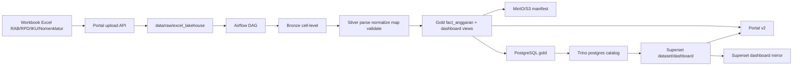

# SILARAS SD — Panduan Pemahaman AI dan Peta Codebase

Dokumen ini adalah peta hidup repository untuk AI dan maintainer. Tujuannya adalah memberi konteks yang cukup agar perubahan berikutnya dimulai dari kontrak dan alur yang sudah ada, bukan dari pembelajaran ulang seluruh repository.

## Status dokumen

| Atribut | Nilai |
|---|---|
| Sistem | SILARAS SD — Sistem Lakehouse Anggaran RAB dan IKU Sains Data |
| Baseline yang dipelajari | commit `9e459e0` |
| Tanggal snapshot | 2026-08-04 |
| Cakupan | source, DAG, portal, dashboard mirror, konfigurasi, test, dan dokumentasi yang ada |
| Tingkat keyakinan | Tinggi untuk kontrak yang ditegakkan test/kode; sedang untuk area legacy yang ditandai di bagian “Ambiguitas” |
| Dokumen domain | [CONTEXT.md](../CONTEXT.md) |

Jika kode berubah setelah baseline ini, ikuti [AI-DOCUMENTATION-MAINTENANCE.md](AI-DOCUMENTATION-MAINTENANCE.md) sebelum menganggap peta ini masih mutakhir.

## Cara membaca repository

Urutan paling aman untuk AI:

1. Baca `AGENTS.md`, [CONTEXT.md](../CONTEXT.md), dan dokumen ini.
2. Baca `README.md` untuk orientasi pengguna dan daftar command.
3. Tentukan area perubahan: ingestion/parser, transform/Gold, orchestration, backend API, frontend, Superset, atau test.
4. Baca test area tersebut sebelum menyentuh implementasi; test sering mengekspresikan kontrak yang lebih baru daripada README.
5. Telusuri lineage file dan identitas `dataset_session_id`/`pipeline_run_id` sebelum menilai sebuah artefak sebagai “aktif”.
6. Setelah perubahan, perbarui bagian dokumen yang terpengaruh dan catat commit snapshot baru.

## Gambaran sistem



Arsitektur yang benar-benar dieksekusi oleh pipeline Python saat ini menggunakan `pandas` dan `openpyxl`. Spark tersedia di Docker Compose sebagai platform lakehouse, tetapi pipeline Python yang menjadi entry point utama tidak mengirim job Spark secara langsung.

## Peta repository

| Lokasi | Peran | Entry point / catatan |
|---|---|---|
| `dags/` | Definisi orkestrasi Airflow | `keuangan_prodi_excel_lakehouse_dag.py` |
| `src/common/` | Path, konfigurasi env, waktu, klasifikasi workbook | dibaca hampir semua layer |
| `src/excel_ingestion/` | Ekstraksi sel Excel dan normalisasi primitive | Bronze, `ExcelSource` |
| `src/parser_flexible/` | Parser RAB dan Nomenklatur yang toleran terhadap variasi workbook | Silver awal |
| `src/transformations/` | Cleaning, mapping enrichment, pipeline utama | `excel_lakehouse_pipeline.py` |
| `src/gold/` | Pembentukan fact table dan alokasi IKU | `fact_anggaran.py` |
| `src/validation/` | Dataset contract, Gold quality gate, cross-engine validation | blocking sebelum publish |
| `src/storage/` | Manifest layer dan optional upload MinIO | `excel_storage_manifest.py` |
| `src/sql/` | Publish PostgreSQL, setup Superset, query/schema | bukan parser |
| `src/status/` | System truth agregat | dibaca backend dan portal |
| `src/metrics/` | latency, freshness, UAT, count validation | artefak `outputs/metrics`/`outputs/reports` |
| `portal_backend/` | Flask API dan adapter ke Airflow/Superset/filesystem | port default 8091 |
| `portal/` | frontend statis; `v2/index.html` adalah tampilan aktif | port default 8090 |
| `superset-dashboard/` | mirror dashboard dengan proxy server-side ke Superset REST API | port default 8092 |
| `tests/` | pytest unit/integration dan kontrak frontend | `tests/playwright/` untuk E2E |
| `config/` | konfigurasi Airflow, Spark, Trino, Superset | dipasang ke container |
| `data/` | raw dan generated layer | jangan dianggap sumber aktif tanpa pointer/manifest |
| `outputs/reports/` | pointer, manifest, status, audit, report run | identitas run wajib diperhatikan |

## Runtime dan service

| Service | Default host port | Fungsi |
|---|---:|---|
| Portal frontend | 8090 | static `portal/server.py`, menyajikan `portal/v2/index.html` |
| Portal backend | 8091 | Flask `portal_backend.app:app` |
| Airflow | 8085 | webserver API dari host; 8080 antar-container |
| Trino | 8082 | query engine; 8080 antar-container |
| Superset | 8089 | BI dan REST API |
| MinIO API/console | 9000/9001 | object storage |
| PostgreSQL/metastore | 5432 | metadata, Airflow, dan schema `gold` |
| Spark master/worker | 8080/8081 UI | platform processing yang tersedia |
| Superset mirror | 8092 | Flask proxy + static dashboard |

Compose utama ada di `docker-compose.yml`. Script lokal `scripts/start_portal_backend.ps1` menyalakan backend dan frontend jika port belum listen; Playwright memakai script ini melalui `playwright.config.ts`.

## Alur upload dan kontrak dataset

Entry point HTTP: `POST /api/upload/excel-dataset` (alias `POST /api/upload/excel-lakehouse`) di `portal_backend/app.py`.

1. Frontend mengumpulkan satu atau beberapa workbook `.xlsx`, `.xlsm`, `.xltx`, atau `.xltm`.
2. `portal_backend/services/excel_upload.py` menerima mode `single` atau `multi`, metadata per file/bundel, dan pilihan target dashboard.
3. File disimpan lebih dulu ke `data/uploads/staging/<dataset_id>`.
4. Setiap file harus dapat dibuka oleh `openpyxl`, tidak kosong, tidak melebihi batas upload, memiliki nama aman, dan memiliki SHA-256.
5. Setelah seluruh bundle lolos, staging dipindahkan ke `data/raw/excel_lakehouse/<target_year>/<dataset_id>`; registry dan pointer aktif ditulis setelah pemindahan.
6. Pointer utama: `outputs/reports/active_excel_lakehouse_dataset.json`; registry: `outputs/reports/excel_dataset_registry.json`.

`src/validation/dataset_contract.py` adalah gerbang canonical production. Payload valid harus:

- `status == committed` dan `upload_state == COMMITTED`;
- memiliki `dataset_session_id` dan daftar file;
- file berada di dalam repository dan canonical raw root;
- bukan berasal dari path `fixture`, `synthetic`, `sample`, `dummy`, `test-session`, atau `archive`;
- ekstensi dan checksum cocok;
- memiliki minimal satu workbook RAB/RPD dan satu workbook Nomenklatur.

`src/common/workbook_kind.py` dan `normalize_dataset_file_kinds()` memperbaiki metadata jenis yang salah jika nama file jelas menunjukkan RAB atau Nomenklatur. Jangan menghapus normalisasi ini tanpa memperbarui test kontraknya.

## Pipeline data: Bronze → Silver → Gold

### Bronze

`src/excel_ingestion/excel_cell_extractor.py` memakai dua workbook view: `data_only=False` untuk formula/style dan `data_only=True` untuk nilai terhitung. Setiap sel yang memiliki nilai, formula, fill, atau merged range menjadi baris Bronze. Metadata penting: file/sheet/row/column/cell address, value, formula, number format, fill, font, border, alignment, merged range, dan waktu ekstraksi.

Output utama: `data/generated/bronze/bronze_excel_cells.csv` dan `.parquet`, termasuk salinan session/run.

### Parsing Silver

`src/parser_flexible/rab_parser.py` memilih dua jalur:

- simple table jika sheet `RAB` memiliki `kode_akun`, `nama_kegiatan`, dan `total_pagu`;
- parser workbook fleksibel jika tidak.

Untuk parser fleksibel:

- sheet diklasifikasikan menjadi `main_rab`, `detail_support`, `mapping_or_reference`, `reconciliation`, dan role lain;
- warna baris membangun hierarki Nomenklatur/Kegiatan/Unit/Akun;
- header dicari mundur sampai 30 baris dan kolom nominal dipilih berdasarkan label semantik, lalu fallback ke nominal paling kanan;
- layout 2025 mengenali kolom tetap khusus;
- formula error seperti `#REF!`, `#VALUE!`, `#N/A`, `#DIV/0!`, dan `#NAME?` dicatat sebagai validasi;
- formula pada kolom P dipakai untuk menghitung row coverage. Leaf item `main_rab` yang tidak tercakup menjadi `orphan_leaf_item` dan tidak masuk Gold;
- subtotal, total, header, blank/note, template, dan mapping reference tidak menjadi item Gold;
- jika ada `main_rab`, sheet `detail_support` hanya untuk audit dan rekonsiliasi agar tidak double count.

`src/parser_flexible/nomenklatur_parser.py` membaca sheet `Nomenklatur FS` atau sheet pertama. Warna memetakan level `KEGIATAN`, `KRO`, `RO`, `KOMPONEN`, dan `SUB_KOMPONEN`; baris lain menjadi detail. Bridge detail-IKU dibuat dengan `allocation_weight = 1 / jumlah IKU`.

### Normalisasi dan mapping

`src/transformations/budget_cleaning.py` memperbaiki teks, kegiatan, akun, dan mapping:

- kode akun valid harus berupa enam digit dengan prefix `51`, `52`, `53`, atau `57` dan tidak menjadi kode agregat yang diakhiri `000` kecuali dikenal;
- akun dapat berasal dari source atau diinferensikan dari konteks uraian/kegiatan;
- mapping IKU mencoba source IKU, aturan keyword Nomenklatur, konteks aktivitas, token overlap, fuzzy text, lalu suggestion operasional;
- `outputs/reports/iku_review_overrides.json` dapat memberi override manual per `item_id`;
- hasil publik berupa `mapping_status`, `mapping_method`, `data_quality_flag`, `kode_iku`, `nama_iku`, dan `nomenklatur_path`.

`src/mapping/flexible_mapping.py` membuat tabel inventaris mapping sumber. Ia bukan pengganti enrichment di `budget_cleaning.py`; keduanya mempunyai peran berbeda.

### Gold dan grain

`src/gold/fact_anggaran.py` membangun `fact_anggaran` dengan grain kanonik:

```text
1 baris = 1 item anggaran × 1 IKU allocation
```

Aturan penting:

- sumber `main_rab` dipilih jika workbook memiliki main RAB;
- hanya baris `include_in_gold == true` yang dipertahankan;
- row type subtotal/total/orphan/blank dibuang;
- item tanpa IKU mendapat label `IKU belum terklasifikasi`;
- item dengan N IKU menjadi N baris, masing-masing `allocation_weight = 1/N`;
- `jumlah_weighted_iku = jumlah × allocation_weight`;
- quality gate memeriksa uniqueness `(item_id, kode_iku)`, lineage, ID dataset/run, angka, dan rumus weighted.

Kolom faktual utama: `item_id`, `dataset_session_id`, `run_id`, `tahun`, `periode`, `prodi`, `fakultas`, `kegiatan`, `cluster_kegiatan`, `akun`, `kode_akun`, `nama_akun`, `iku`, `kode_iku`, `nama_iku`, `nomenklatur_path`, `uraian_detail`, `qty`, `satuan`, `harga_satuan`, `jumlah`, `jumlah_weighted_iku`, `allocation_weight`, status kualitas/mapping, lineage source, row type, dan `created_at`.

### Identitas output dan publish

`src/transformations/excel_lakehouse_pipeline.py`:

1. memilih source berdasarkan pointer dataset aktif;
2. menulis lifecycle `RUNNING`;
3. mengarsipkan source luar ke raw archive;
4. mengekstrak Bronze dan mem-parsing RAB/Nomenklatur;
5. membangun Silver, mapping, cleaning, dan Gold;
6. menulis CSV + Parquet pada path run-scoped, session-scoped, dan top-level active snapshot;
7. mengevaluasi `evaluate_gold_quality()`;
8. hanya jika lulus, menulis `active_gold_run.json` dengan status `PUBLISHED` dan report rekonsiliasi.

Artefak layer yang diharapkan:

| Layer | Artefak penting |
|---|---|
| Bronze | `bronze_excel_cells` |
| Silver | `silver_rab_items_flexible`, `silver_rab_rows_classified`, `silver_rab_formula_coverage`, `silver_rab_orphan_items`, `silver_detail_support_items`, `silver_rab_hierarchy`, `silver_mapping`, `silver_validation`, `silver_nomenklatur_detail`, `silver_bridge_detail_iku`, `silver_nomenklatur_warnings` |
| Gold | `fact_anggaran`, `vw_dashboard_iku_anggaran`, `vw_dashboard_mapping_quality`, `vw_dashboard_reconciliation`, `vw_dashboard_detail_item` |

Metadata pipeline: `data/generated/excel_lakehouse_metadata.json`. Report run: `outputs/reports/pipeline_runs/<pipeline_run_id>.json`.

## Orkestrasi Airflow

DAG `keuangan_prodi_excel_lakehouse_dag` bersifat manual (`schedule=None`, `catchup=False`, `max_active_runs=1`). Config yang dibawa dari portal:

```text
dataset_session_id
pipeline_run_id
dashboard_mode
dashboard_database_id
dashboard_dashboard_id
```

Urutan task:

```text
start
→ validate_upload_context
→ extract_excel_to_bronze
→ detect_year_and_format
→ parse_flexible
→ merge_multi_file
→ normalize_silver
→ map_iku_and_nomenklatur
→ validate_excel_totals
→ build_fact_anggaran
→ write_minio_storage
→ load_gold_to_postgres
→ validate_trino_postgres_catalog
→ refresh_superset_dataset
→ refresh_superset_dashboard
→ generate_storage_manifest
→ generate_system_status
→ end
```

Sebagian tahap Medallion di tengah adalah `EmptyOperator` sebagai penanda progres; transformasi aktual utama berada dalam script pipeline. Task `write_minio_storage` menjalankan manifest dengan upload aktif; task akhir menjalankan manifest lagi tanpa upload untuk menghasilkan snapshot status lokal.

Backend Airflow adapter (`portal_backend/services/airflow.py`) mengelompokkan task ke stage `raw`, `bronze`, `silver`, `gold`, `bi`. Sumber durasi adalah `duration` atau selisih timestamp task dari Airflow; task yang masih berjalan tidak dihitung memakai jam browser.

## Publish storage dan query engine

### MinIO/S3 manifest

`src/storage/excel_storage_manifest.py` memetakan direktori `raw`, `bronze`, `silver`, `gold`, `reports`, dan `logs` ke prefix bucket. `MINIO_UPLOAD_ENABLED=false` berarti artefak hanya berstatus `mapped_not_uploaded`; upload nyata memerlukan endpoint/credential dari environment. Jangan menyimpulkan “uploaded” hanya karena file lokal ada.

### PostgreSQL

`src/sql/load_gold_to_postgres.py` hanya boleh memuat `active_gold_run.json` berstatus `PUBLISHED` dengan session/run yang cocok. Ia membuat schema staging per run, memuat CSV melalui `COPY`, memvalidasi row count dan weighted total, kemudian mengganti schema/table `gold` dalam transaksi. Kegagalan rollback dan tidak boleh mempublikasikan partial Gold.

### Trino

`src/validation/runtime_cross_engine.py` membandingkan PostgreSQL dan Trino untuk dataset/run yang sama: row count, unique item, dan weighted total. Hasil ditulis ke `outputs/reports/trino_postgres_catalog_status.json` dan manifest run.

### Superset

`src/sql/setup_superset_excel_assets.py` login melalui REST API, mencari/membuat database Trino, memastikan dataset `gold.fact_anggaran`, menyegarkan metadata, menyembunyikan kolom teknis dari UI, membuat saved query, dan upsert dashboard/charts. Tabel faktual tetap memiliki kolom teknis untuk lineage/QA. Target database/dashboard dapat diarahkan dengan ID; ID database eksplisit yang tidak ada bersifat fail-fast, sedangkan target dashboard dapat fallback sesuai kode setup.

## Backend portal

`portal_backend/app.py` adalah Flask app dan delegator ke service kecil. Endpoint dibagi menjadi:

| Area | Endpoint utama | Sumber |
|---|---|---|
| Health/readiness | `/api/health`, `/api/readiness`, `/api/production/readiness` | filesystem, system truth, release gate |
| Runtime/status | `/api/runtime-config`, `/api/runtime-context`, `/api/status/services`, `/api/system-truth/status`, `/api/metrics`, `/api/activity` | config, report, network probe |
| Upload/dataset | `/api/upload/excel-dataset`, `/api/upload/session/status`, `/api/datasets`, `/api/excel-lakehouse/status` | raw files + pointer + metadata |
| Airflow | `/api/airflow/trigger`, `/api/airflow/active`, `/api/airflow/latest`, `/api/airflow/runtime`, `/api/airflow/runs` | Airflow REST API |
| Data preview | `/api/data/preview`, `/api/preview/<layer>`, `/api/data/rejected-rows`, `/api/data-quality/<run_id>` | CSV/artifact lokal |
| Review | `/api/iku-review/queue`, `/api/mapping-review/queue`, `/api/iku-review/override` | Silver/Gold + override JSON |
| Storage/report | `/api/storage/manifest`, `/api/storage/manifest/<run_id>`, `/api/reports/bab4-evidence` | report JSON |
| Dashboard lokal | `/api/local-dashboard/all`, `/status`, `/filters`, `/summary`, `/charts`, `/table` | Superset API lalu Gold fallback |
| Superset | `/api/superset/status`, `/summary`, `/assets`, `/databases`, `/dashboards`, `/chart-data` | Superset REST/API + report |
| UAT | `/api/uat/summary`, `/api/uat/submit` | official report + local submissions |

Mutating `/api/*` dapat diwajibkan memakai `PORTAL_API_TOKEN` bila `PORTAL_AUTH_REQUIRED` diaktifkan. Batas upload backend default 100 MB. Endpoint perubahan dataset/pipeline juga mengubah file report/runtime; jangan memanggilnya dalam inspeksi read-only.

## Portal v2

Frontend primer adalah `portal/v2/index.html`; `portal/server.py` memetakan `/`, `/legacy`, dan `/v2` ke halaman V2. Alias `/legacy` saat ini juga menyajikan V2 menurut implementasi dan test; jangan menganggap tersedia UI V1 terpisah.

V2 membangun view model dari endpoint authoritative berikut:

```text
/api/superset/summary
/api/metrics
/api/airflow/active
/api/airflow/latest
/api/system-truth/status
/api/excel-lakehouse/status
```

Polling: status Airflow sekitar 10 detik, dashboard sekitar 30 detik pada halaman relevan, fitur sekitar 45 detik, dan ticker stepper 1 detik hanya ketika ada stage berjalan. Fetch menggunakan cache/deduplication, `Promise.allSettled`, dan status partial/unreachable.

Stepper Medallion memakai stage `raw → bronze → silver → gold → bi`. `renderLiveStepper()` menampilkan jumlah task, persentase, task aktif, status, dan durasi per stage dari payload Airflow. Nilai durasi tidak boleh dibuat dari `Date.now()` browser. `safe()`/`escapeHtml()` wajib dipakai ketika data backend atau user masuk ke HTML.

Alur mutasi portal:

```text
Upload Data → POST /api/upload/excel-dataset
Jalankan Sistem → POST /api/airflow/trigger → poll /api/airflow/runs/<dag_run_id>
Review IKU → POST /api/iku-review/override → jalankan ulang pipeline
Submit UAT → POST /api/uat/submit (juga menyimpan histori lokal)
```

## Dashboard lokal dan mirror Superset

`portal_backend/services/local_dashboard.py` memiliki adapter legacy untuk view `vw_dashboard_piutang_ukt`. Untuk mode SILARAS, urutan sumber yang diterapkan kode adalah:

1. view legacy jika file tersedia;
2. Superset REST `/api/v1/chart/data` jika reference dataset tersedia;
3. fallback faktual `data/generated/gold/fact_anggaran.csv`.

`superset-dashboard/` tidak membaca database secara langsung. Browser memanggil proxy Flask (`/api/dashboards`, `/api/dashboard/<id>/meta`, `/api/chart/<id>/data`), lalu server yang login ke Superset. `lib/_shared.py` memiliki cache meta dashboard dan cache chart sekitar 60 detik; credential hanya server-side.

## Artefak status dan source-of-truth

| Artefak | Makna |
|---|---|
| `outputs/reports/active_excel_lakehouse_dataset.json` | dataset upload yang sedang aktif dan committed |
| `outputs/reports/excel_dataset_registry.json` | histori dataset yang pernah di-commit |
| `outputs/reports/active_gold_run.json` | Gold yang sudah lulus gate dan berstatus `PUBLISHED` |
| `outputs/reports/pipeline_runs/<run>.json` | lifecycle dan hasil satu run |
| `outputs/reports/pipeline_run_summary.json` | ringkasan pipeline yang dipakai beberapa consumer lama |
| `outputs/reports/storage_manifest.json` | pemetaan layer lokal ke object storage |
| `outputs/reports/system_truth_status.json` | snapshot agregat untuk portal/status |
| `outputs/reports/trino_postgres_catalog_status.json` | hasil cross-engine validation |
| `outputs/reports/superset_excel_dashboard.json` / `superset_excel_assets.json` | reference dataset/dashboard Superset |
| `outputs/reports/iku_review_overrides.json` | override mapping per item |

Artefak top-level `data/generated/*` adalah active snapshot; path session/run adalah lineage historis. Jika ada konflik, gunakan pointer identity dan status, bukan timestamp file atau jumlah baris yang berdiri sendiri.

## Test map

| Kelompok | File/pola | Kontrak yang dijaga |
|---|---|---|
| Dataset/source guard | `test_dataset_contract.py`, `test_production_source_guard.py` | committed, checksum, canonical raw, RAB + Nomenklatur, tanpa sample fallback |
| Excel/parser | `test_parse_2023.py`, `test_parse_2024.py`, `test_parse_2025.py`, `test_excel_rab_parser_2025.py`, `test_rab_parser_amount_columns.py`, `test_parse_nomenklatur.py` | period, amount column, warna, formula, orphan, detail support, lineage |
| Gold/quality | `test_fact_anggaran.py`, `test_iku_allocation.py`, `test_production_pipeline_atomic.py`, `test_gold_publish_guards.py` | grain, equal split, weighted total, atomic publish, identifier guard |
| Upload/storage/status | `test_excel_lakehouse_upload_api.py`, `test_production_upload_atomic.py`, `test_excel_storage_manifest.py`, `test_excel_lakehouse_status.py` | staging rollback, append, hash, manifest, active-only counts |
| Backend/Airflow | `test_airflow_trigger.py`, `test_portal_routes.py`, `test_portal_backend_interactions.py`, `test_readiness_endpoints.py` | trigger identity, dedupe, active-run priority, API status |
| Security | `test_portal_security.py`, `test_security_config.py`, `test_production_readiness.py` | auth fail-closed, credential checks, readiness gate |
| Frontend contract | `test_portal_v2_contract.py`, `test_portal_v2_runtime.py` | authoritative endpoints, safe HTML, live stepper, loading/error, no stale numbers |
| Dashboard bridge | `test_local_dashboard.py`, `test_superset_api_dashboard_bridge.py`, `test_superset_dashboard_target.py`, `test_gold_view_filter_columns.py` | Superset-first/fallback behavior, target selection, hidden technical columns |
| E2E | `tests/playwright/*.spec.ts` | local dashboard, mirror Superset, Medallion runtime |

Test workbook yang tidak tersedia dapat menyebabkan test parser tertentu di-skip; itu bukan bukti bahwa semua path input sudah teruji.

## Aturan perubahan yang aman

1. Jangan menjalankan pipeline, upload, Airflow trigger, `docker compose up`, atau command publish hanya untuk mempelajari repository.
2. Jangan mengganti `active_*` pointer atau mengedit `data/` dan `outputs/` sebagai bagian dari dokumentasi.
3. Perubahan parser harus mempertahankan `source_file`, `source_sheet`, `source_row`, `item_id`, `dataset_session_id`, dan `run_id`.
4. Perubahan Gold harus memeriksa ulang grain, allocation weight, weighted total, dan quality gate.
5. Perubahan upload harus mempertahankan staging rollback, canonical raw guard, checksum, dan append semantics.
6. Perubahan Airflow/backend harus mempertahankan dataset/run identity serta prioritas active run pada progress.
7. Perubahan frontend harus mempertahankan loading/error/partial state, escaping, dan sumber durasi Airflow.
8. Jangan menambahkan fallback sample/dummy ke production path.
9. Jangan memasukkan credential, token, isi `.env`, atau data workbook ke dokumentasi.

## Ambiguitas dan legacy yang harus diketahui AI

- `docs/architecture.md` masih menyebut `src/validation/excel_count_validation.py`, sedangkan entry point aktual yang dipakai README/Makefile adalah `src/metrics/validate_excel_lakehouse_counts.py`.
- README menyebut portal V2 sebagai primer dan V1 sebagai fallback, tetapi route `/legacy` pada server saat ini mengarah ke V2; test juga mengunci perilaku alias tersebut.
- `portal_backend/services/local_dashboard.py` mempertahankan nama/kontrak legacy piutang (`vw_dashboard_piutang_ukt`) walaupun mode SILARAS memakai `fact_anggaran`; baca adapter dan test sebelum mengubah payload.
- `portal/v2/index.html` preview dashboard lama mengharapkan beberapa key ringkasan (`total_anggaran`, `total_rows`, `total_akun`) yang tidak identik dengan semua key yang dikembalikan adapter local dashboard; jangan menyamakan keduanya tanpa test.
- Docker Compose menyediakan Spark/Iceberg, tetapi entry point Python utama saat ini menggunakan pandas/openpyxl dan publish PostgreSQL/Trino/Superset.
- Beberapa command README memakai PowerShell, sedangkan `superset-dashboard/README.md` memakai Bash. Dokumentasikan shell yang dipakai saat menambah command baru.

Ambiguitas di atas dicatat agar AI tidak “memperbaiki” perilaku legacy secara diam-diam. Jika ingin mengubahnya, perlakukan sebagai perubahan kontrak dan update test, README, dokumen ini, serta maintenance log.

