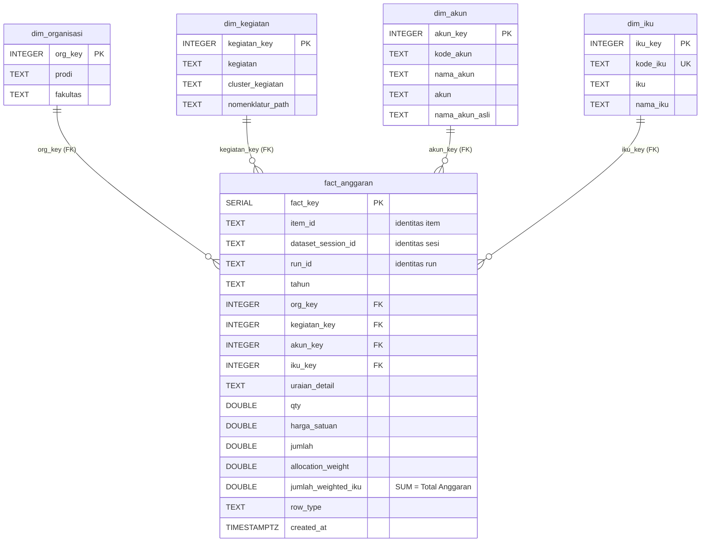

# ER Diagram Star Schema Gold — SILARAS SD

> Sumber kebenaran: FK live di Postgres `metastore` schema `gold`
> (4 FK: `fact_anggaran_org_key_fkey`, `fact_anggaran_kegiatan_key_fkey`,
> `fact_anggaran_akun_key_fkey`, `fact_anggaran_iku_key_fkey`) dan
> `src/sql/create_gold_tables.sql`.

## Cara melihat diagram relasi

1. **DBeaver** — double-click `gold.fact_anggaran` → tab *ER Diagram*, atau klik kanan schema `gold` → *View Diagram*.
2. **pgAdmin 4** — klik kanan schema `gold` → *ERD For the database*.
3. **Mermaid/draw.io** — copy blok `mermaid` di bawah ke <https://mermaid.live> atau draw.io (*Arrange → Insert → Advanced → Mermaid*).

## Diagram relasi

## Catatan

- View `gold.vw_fact_anggaran` adalah rekonstruksi flat (JOIN 4 dim) untuk
  Superset/portal — bukan tabel fisik, tidak muncul di ERD.
- View analitik: `vw_dashboard_iku_anggaran`, `vw_dashboard_mapping_quality`,
  `vw_dashboard_reconciliation` — agregasi di atas `vw_fact_anggaran`.
- Grain fact: satu item anggaran x satu alokasi IKU.
