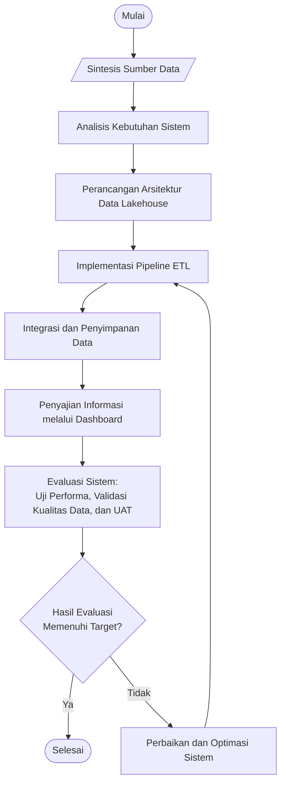
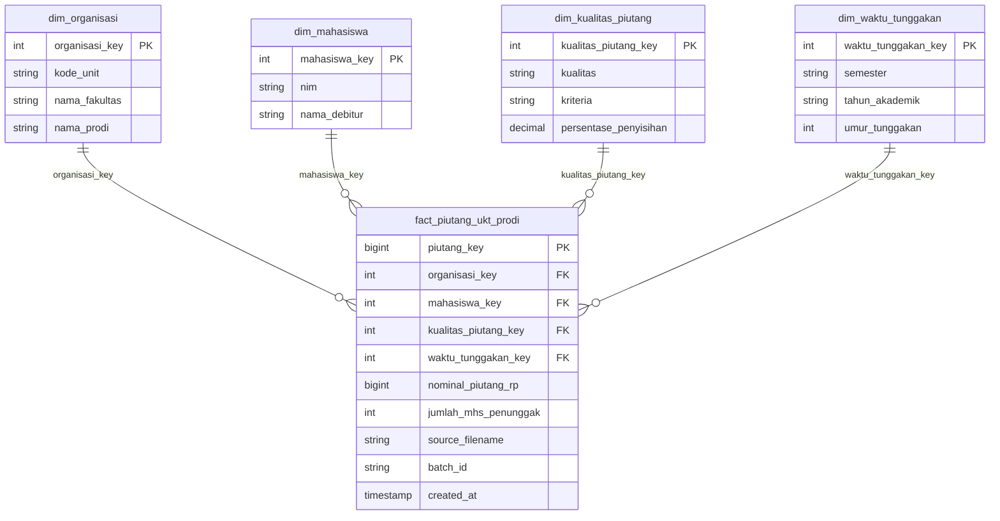

# Markdown Plan End-to-End: Implementasi Data Lakehouse Medallion untuk Data Keuangan Perguruan Tinggi

## 0. Tujuan Dokumen

Dokumen ini menjadi **rencana kerja utama** untuk Agent AI dalam membangun sistem end-to-end Data Lakehouse berbasis Medallion Architecture untuk data keuangan perguruan tinggi. Sistem harus mampu membuat data dummy, memproses PDF/CSV/Excel, menjalankan pipeline ETL, menyimpan data ke Bronze-Silver-Gold, membentuk Star Schema, menghubungkan Gold Layer ke Trino, membuat dashboard Superset, dan menyiapkan evaluasi performa serta UAT.

Agent wajib bekerja secara bertahap, terdokumentasi, dan menggunakan **MCP Context7** untuk membaca dokumentasi resmi/best practice sebelum menulis konfigurasi atau kode penting. Agent juga wajib mencari skill yang relevan melalui perintah `npx skills add https://github.com/vercel-labs/skills --skill find-skills` sebelum mengerjakan bagian besar, lalu menggunakan skill yang paling sesuai.

---

## 1. Konteks Sistem yang Harus Dibangun

### 1.1 Judul Sistem

**Perancangan dan Implementasi Data Lakehouse Berbasis Arsitektur Medallion pada Data Keuangan Perguruan Tinggi**

### 1.2 Tujuan Sistem

Sistem dibangun untuk:

1. Mengintegrasikan data keuangan multi-format berupa PDF laporan audited, CSV transaksi pembayaran, dan Excel RAB.
2. Membangun pipeline ETL berbasis Airflow, Spark, MinIO, Iceberg, Trino, dan Superset.
3. Membentuk Gold Layer berbasis Star Schema untuk analisis piutang UKT prodi.
4. Menyajikan dashboard analitik Superset.
5. Mengevaluasi pipeline melalui Pipeline Latency, Data Freshness, Dropout Rate, Data Quality Score, dan validasi rekonsiliasi nilai kontrol.
6. Menyiapkan instrumen UAT untuk menilai penerimaan dashboard oleh pengguna akhir.

### 1.3 Lingkup Implementasi

Sistem berjalan lokal menggunakan Docker Compose. Data yang digunakan adalah data dummy/simulasi, bukan data riil mahasiswa. Data dummy harus mengikuti atribut dan nilai kontrol berikut:

| Sumber Data | Format | Ketentuan |
|---|---|---|
| PDF laporan audited | `.pdf` | 803 baris lampiran piutang, termasuk 15 mahasiswa Prodi Sains Data |
| CSV transaksi | `.csv` | 2 file log pembayaran semester ganjil dan genap, sekitar 800 riwayat transaksi |
| Excel RAB | `.xlsx` | 1 file RAB Prodi Sains Data dengan struktur bulan melebar |

Nilai kontrol utama:

| Kontrol | Nilai |
|---|---:|
| Total tunggakan UKT Prodi Sains Data | Rp31.250.000 |
| Jumlah mahasiswa penunggak Prodi Sains Data | 15 mahasiswa |
| Total pagu RAB Prodi Sains Data | Rp150.000.000 |

---

## 2. Aturan Kerja Agent AI

### 2.1 Prinsip Utama

Agent harus bekerja dengan prinsip berikut:

1. **Documentation-first**: sebelum menulis konfigurasi atau kode utama, baca dokumentasi melalui MCP Context7.
2. **Skill-first**: sebelum mengerjakan bagian besar, cari skill yang relevan dengan `find-skills`.
3. **Checkpoint-based**: setiap tahap harus menghasilkan checkpoint markdown agar pengerjaan bisa dilanjutkan jika token/session habis.
4. **Reproducible**: semua proses harus bisa dijalankan ulang dari awal dengan command yang jelas.
5. **End-to-end runnable**: target akhir adalah sistem dapat berjalan dari generate data dummy sampai dashboard siap dibuka.
6. **No real personal data**: semua data mahasiswa, NIM, nama, transaksi, dan piutang harus dummy.
7. **Audit-friendly**: setiap data yang diproses harus memiliki metadata asal file, waktu proses, dan status validasi.

### 2.2 Perintah Awal Wajib

Agent harus menjalankan atau menyiapkan perintah berikut sebelum masuk implementasi:

```bash
# Install skill finder
npx skills add https://github.com/vercel-labs/skills --skill find-skills
```

Lalu cari skill sesuai bagian kerja:

```bash
# Contoh pencarian skill
npx skills find "docker compose data engineering"
npx skills find "apache airflow dag"
npx skills find "spark etl python"
npx skills find "minio s3 object storage"
npx skills find "apache iceberg trino"
npx skills find "superset dashboard"
npx skills find "data quality validation"
npx skills find "synthetic data generation python"
```

Jika command aktual berbeda pada environment agent, agent harus menyesuaikan, tetapi tujuan utamanya tetap sama: mencari skill yang relevan sebelum mengerjakan task.

### 2.3 MCP Context7 Wajib Digunakan untuk Dokumentasi

Gunakan MCP Context7 untuk membaca dokumentasi/best practice sebelum mengerjakan bagian berikut:

| Komponen | Dokumentasi yang Dicari via Context7 |
|---|---|
| Docker Compose | service networking, volume, healthcheck, depends_on |
| MinIO | bucket, access key, S3 endpoint, Python client/boto3 |
| Apache Airflow | DAG, task dependency, Docker deployment, SparkSubmitOperator |
| Apache Spark | PySpark read/write CSV, Excel handling, Iceberg integration |
| Apache Iceberg | catalog, table creation, Spark integration, Trino connector |
| Trino | Iceberg connector, catalog properties, SQL query |
| Superset | database connection, dataset, chart/dashboard setup |
| Python PDF extraction | pdfplumber/pypdf text extraction, regex parsing |
| Data quality | validation rules, quarantine pattern, logging |

Template instruksi Context7 untuk agent:

```text
Gunakan MCP Context7 untuk membuka dokumentasi resmi komponen [NAMA_KOMPONEN]. Fokus pada best practice konfigurasi Docker/local development, integrasi dengan komponen lain, contoh konfigurasi minimal, dan hal yang harus dihindari. Ringkas hasil bacaan ke dalam file docs/context7-notes/[komponen].md sebelum menulis kode.
```

---

## 3. Struktur Repository yang Harus Dibuat

Agent harus membuat struktur proyek seperti berikut:

```text
data-lakehouse-keuangan-prodi/
├── README.md
├── docker-compose.yml
├── .env.example
├── .gitignore
├── Makefile
├── docs/
│   ├── architecture.md
│   ├── context7-notes/
│   │   ├── docker.md
│   │   ├── minio.md
│   │   ├── airflow.md
│   │   ├── spark.md
│   │   ├── iceberg.md
│   │   ├── trino.md
│   │   ├── superset.md
│   │   └── data-quality.md
│   ├── checkpoints/
│   │   ├── CHECKPOINT-00-setup.md
│   │   ├── CHECKPOINT-01-dummy-data.md
│   │   ├── CHECKPOINT-02-docker-stack.md
│   │   ├── CHECKPOINT-03-bronze.md
│   │   ├── CHECKPOINT-04-silver.md
│   │   ├── CHECKPOINT-05-gold.md
│   │   ├── CHECKPOINT-06-airflow.md
│   │   ├── CHECKPOINT-07-trino-superset.md
│   │   ├── CHECKPOINT-08-testing.md
│   │   └── CHECKPOINT-09-final-run.md
│   └── diagrams/
│       ├── flowchart.mmd
│       ├── architecture.mmd
│       └── star-schema.mmd
├── config/
│   ├── trino/
│   │   ├── etc/
│   │   └── catalog/
│   │       └── iceberg.properties
│   ├── spark/
│   │   ├── spark-defaults.conf
│   │   └── jars/
│   ├── airflow/
│   │   └── airflow.cfg
│   └── superset/
│       └── superset_config.py
├── data/
│   ├── raw/
│   │   ├── pdf/
│   │   ├── csv/
│   │   └── excel/
│   ├── generated/
│   ├── quarantine/
│   └── samples/
├── src/
│   ├── common/
│   │   ├── config.py
│   │   ├── logging_utils.py
│   │   ├── minio_client.py
│   │   └── time_utils.py
│   ├── generators/
│   │   ├── generate_all.py
│   │   ├── generate_pdf_audited.py
│   │   ├── generate_csv_transactions.py
│   │   └── generate_excel_rab.py
│   ├── extraction/
│   │   ├── extract_pdf_piutang.py
│   │   ├── extract_csv_transactions.py
│   │   └── extract_excel_rab.py
│   ├── validation/
│   │   ├── quality_gate.py
│   │   ├── rules.py
│   │   └── quarantine.py
│   ├── transformations/
│   │   ├── bronze_ingest.py
│   │   ├── silver_clean.py
│   │   ├── silver_unpivot_rab.py
│   │   └── gold_star_schema.py
│   ├── metrics/
│   │   ├── pipeline_latency.py
│   │   ├── data_freshness.py
│   │   ├── dropout_rate.py
│   │   ├── data_quality_score.py
│   │   └── reconcile_control_total.py
│   └── sql/
│       ├── create_gold_tables.sql
│       ├── trino_validation_queries.sql
│       └── superset_datasets.sql
├── dags/
│   └── keuangan_prodi_lakehouse_dag.py
├── tests/
│   ├── test_dummy_data.py
│   ├── test_quality_gate.py
│   ├── test_reconciliation.py
│   └── test_metrics.py
└── outputs/
    ├── reports/
    ├── metrics/
    └── uat/
```

---

## 4. Data Dummy yang Harus Dibuat

### 4.1 Prinsip Data Dummy

Data dummy harus realistis, konsisten, dan dapat direkonsiliasi. Agent harus memastikan total piutang untuk 15 mahasiswa Prodi Sains Data sama dengan Rp31.250.000.

### 4.2 Atribut PDF Lampiran Piutang

Buat PDF digital, bukan hasil scan. PDF harus dapat dibaca oleh `pdfplumber` atau `pypdf`.

Atribut minimum:

| Atribut | Tipe | Keterangan |
|---|---|---|
| `nim` | string | NIM dummy mahasiswa |
| `nama_debitur` | string | Nama dummy mahasiswa |
| `fakultas` | string | Fakultas mahasiswa |
| `prodi` | string | Program studi mahasiswa |
| `semester` | string | Ganjil/Genap |
| `tahun_akademik` | string | Contoh: 2023/2024 |
| `umur_tunggakan` | integer | Umur tunggakan dalam semester |
| `kualitas` | string | Lancar, Kurang Lancar, Diragukan, Macet |
| `persentase_penyisihan` | decimal | 0.5, 10, 50, atau 100 |
| `nominal_piutang_rp` | integer | Nilai tunggakan |

Ketentuan khusus:

1. Total baris PDF: 803 baris.
2. Minimal 15 baris adalah Prodi Sains Data.
3. Total nominal piutang untuk 15 mahasiswa Sains Data: Rp31.250.000.
4. Nama mahasiswa harus dummy.
5. Harus ada bagian CaLK/daftar kualitas piutang di PDF agar bisa membentuk `dim_kualitas_piutang`.
6. PDF harus memiliki teks yang bisa diekstrak, bukan gambar.

Contoh distribusi 15 mahasiswa Sains Data:

| No | Nominal |
|---:|---:|
| 1 | 2.500.000 |
| 2 | 2.500.000 |
| 3 | 2.250.000 |
| 4 | 2.250.000 |
| 5 | 2.000.000 |
| 6 | 2.000.000 |
| 7 | 2.000.000 |
| 8 | 2.000.000 |
| 9 | 1.750.000 |
| 10 | 1.750.000 |
| 11 | 1.750.000 |
| 12 | 1.750.000 |
| 13 | 1.500.000 |
| 14 | 1.500.000 |
| 15 | 4.000.000 |
| **Total** | **31.250.000** |

### 4.3 Atribut CSV Transaksi

Buat dua file:

```text
data/raw/csv/transaksi_ganjil.csv
data/raw/csv/transaksi_genap.csv
```

Atribut minimum:

| Atribut | Tipe | Keterangan |
|---|---|---|
| `transaction_id` | string | ID transaksi unik |
| `nim` | string | NIM mahasiswa |
| `tanggal` | date | Tanggal pembayaran |
| `semester` | string | Ganjil/Genap |
| `tahun_akademik` | string | Tahun akademik |
| `nominal_bayar` | integer | Nominal pembayaran |
| `metode_bayar` | string | VA, transfer, loket |
| `status_bayar` | string | paid, partial, unpaid, failed |
| `source_system` | string | Simulasi: AVITA |
| `created_at` | timestamp | Waktu data dibuat |

Ketentuan khusus:

1. Total sekitar 800 transaksi.
2. Harus memuat transaksi mahasiswa Sains Data yang terkait dengan PDF piutang.
3. Harus ada beberapa data tidak valid untuk menguji quality gate, misalnya:
   - NIM kosong.
   - Nominal nonnumerik.
   - Tanggal salah.
   - Status bayar tidak dikenal.
4. Data tidak valid harus kecil, misalnya 1--3% dari total baris.

### 4.4 Atribut Excel RAB

Buat file:

```text
data/raw/excel/rab_prodi_sains_data.xlsx
```

Atribut struktur wide-format:

| Kolom | Keterangan |
|---|---|
| `kode_akun` | Kode akun kegiatan |
| `nama_kegiatan` | Nama kegiatan anggaran |
| `kategori` | Operasional, akademik, praktikum, seminar, publikasi |
| `Jan` s.d. `Des` | Alokasi bulanan |
| `total_pagu` | Total per kegiatan |

Ketentuan khusus:

1. Total pagu seluruh kegiatan harus Rp150.000.000.
2. Struktur Excel dibuat melebar agar perlu proses unpivot ke long-format.
3. Tambahkan sheet metadata berisi tahun anggaran, prodi, fakultas, dan versi dokumen.

---

## 4A. Instruksi Tambahan: Ekstraksi PDF Digital-Born ITERA LKTA 2024

Bagian ini menjadi instruksi wajib untuk Agent AI saat membuat modul ekstraksi PDF pada `src/extraction/extract_pdf_piutang.py`. Modul ini dipakai untuk membaca PDF digital-born seperti `ITERA_LKTA2024Audited.pdf` atau nama file lain yang isinya setara. Agent tidak boleh memakai OCR, Tesseract, image processing, atau computer vision. Proses harus memakai `pdfplumber`, `pypdf`, `re`, dan `pandas`.

### 4A.1 Role Prompt untuk Agent

Gunakan prompt kerja berikut sebelum Agent menulis kode ekstraksi PDF:

```text
Bertindaklah sebagai Senior Data Engineer yang sedang membangun arsitektur Data Lakehouse berbasis Medallion Architecture untuk Sistem Analitik Keuangan Program Studi Universitas.

Buat skrip Python ETL Pipeline menggunakan pdfplumber, pypdf, re/RegEx, dan pandas. Skrip harus mengekstrak data dari PDF digital-born bernama ITERA_LKTA2024Audited.pdf atau nama file lain dengan isi setara. Jangan menggunakan OCR.

Data hasil ekstraksi diposisikan sebagai data Bronze-to-Silver. Output Silver harus siap digunakan untuk membentuk Star Schema pada Gold Layer.
```

### 4A.2 File Input dan Output

| Index | Kode | Path/File | Fungsi |
|---:|---|---|---|
| A.1 | `PDF_INPUT` | `data/raw/pdf/ITERA_LKTA2024Audited.pdf` | File PDF audited digital-born. |
| A.2 | `SILVER_DIM_KUALITAS` | `data/generated/silver/dim_kualitas_piutang.csv` | Output dimensi kualitas piutang. |
| A.3 | `SILVER_FACT_PIUTANG` | `data/generated/silver/fact_piutang_ukt_prodi.csv` | Output data piutang mahasiswa. |
| A.4 | `CONTROL_TOTAL_JSON` | `outputs/metrics/master_control_total.json` | Output angka kontrol dari PDF. |
| A.5 | `EXTRACTION_LOG` | `outputs/metrics/pdf_extraction_log.json` | Log error ekstraksi untuk Dropout Rate. |

### 4A.3 Target Fungsi Ekstraksi

Agent wajib membuat tiga fungsi utama berikut.

| Index | Fungsi | Target | Output |
|---:|---|---|---|
| 1 | `extract_master_control_total(pdf_path)` | Master Control Total dari LRA/Catatan Hasil Reviu. | Dictionary kontrol agregat. |
| 2 | `extract_dim_kualitas_piutang(pdf_path)` | Tabel 1 Kriteria Piutang. | CSV `dim_kualitas_piutang.csv`. |
| 3 | `extract_fact_piutang_ukt_prodi(pdf_path)` | Lampiran debitur piutang UKT mahasiswa. | CSV `fact_piutang_ukt_prodi.csv`. |

### 4A.4 Target 1: Master Control Total

Fungsi `extract_master_control_total()` harus mencari angka pengunci untuk Quality Gate dan rekonsiliasi akhir.

| Index | Target Teks/Informasi | Nilai Target | Kegunaan |
|---:|---|---:|---|
| 1.1 | Pendapatan Penerimaan Negara Bukan Pajak | 170.036.699.916 | Kontrol nilai pendapatan PNBP. |
| 1.2 | Total piutang mahasiswa pada tabel reviu piutang | 4.507.694.500 | Kontrol total piutang mahasiswa. |
| 1.3 | Total mahasiswa penunggak | 803 | Kontrol jumlah baris lampiran. |

Logika kerja:

1. Baca seluruh halaman PDF memakai `pdfplumber`.
2. Simpan teks setiap halaman dalam list berisi `page_number` dan `text`.
3. Cari halaman yang memuat kata kunci `Laporan Realisasi Anggaran`, `Catatan Hasil Reviu`, `Pendapatan Penerimaan Negara Bukan Pajak`, dan `Piutang`.
4. Gunakan RegEx untuk menangkap angka rupiah dari teks.
5. Simpan halaman sumber ke `source_pages` agar lineage tetap jelas.
6. Jika pola tidak ditemukan, catat error ke `pdf_extraction_log.json` dan jangan mengisi nilai palsu.

Contoh struktur fungsi:

```python
def extract_master_control_total(pdf_path: str) -> dict:
    """
    Mengekstrak angka kontrol utama dari PDF audited.

    Target:
    1. Pendapatan PNBP = 170.036.699.916
    2. Total piutang mahasiswa = 4.507.694.500
    3. Total mahasiswa penunggak = 803
    """
    controls = {
        "pendapatan_pnbp": None,
        "total_piutang_mahasiswa": None,
        "jumlah_mahasiswa_penunggak": None,
        "source_pages": [],
        "errors": []
    }
    return controls
```

### 4A.5 Target 2: Parameter Risiko DO atau Dimensi Kualitas Piutang

Fungsi `extract_dim_kualitas_piutang()` harus membaca tabel yang memiliki judul atau header `Tabel 1 Kriteria Piutang`.

| Index | Status | Penyisihan |
|---:|---|---:|
| 2.1 | Lancar | 0.5% |
| 2.2 | Kurang Lancar | 10% |
| 2.3 | Diragukan | 50% |
| 2.4 | Macet | 100% |

Aturan teknis:

1. Cari halaman yang mengandung teks `Tabel 1 Kriteria Piutang`.
2. Gunakan `pdfplumber.extract_table()` sebagai metode utama.
3. Jika tabel tidak terbaca, gunakan fallback RegEx dari teks halaman.
4. Bersihkan teks yang mengandung enter atau baris terpotong memakai fungsi `clean_text()`.
5. Output wajib memiliki kolom `kualitas_piutang_key`, `kualitas`, `kriteria`, dan `persentase_penyisihan`.
6. Simpan hasil ke `data/generated/silver/dim_kualitas_piutang.csv`.

Contoh struktur fungsi:

```python
def extract_dim_kualitas_piutang(pdf_path: str) -> pd.DataFrame:
    """
    Mengekstrak Tabel 1 Kriteria Piutang menjadi dim_kualitas_piutang.
    """
    rows = [
        {"kualitas_piutang_key": 1, "kualitas": "Lancar", "persentase_penyisihan": 0.5},
        {"kualitas_piutang_key": 2, "kualitas": "Kurang Lancar", "persentase_penyisihan": 10.0},
        {"kualitas_piutang_key": 3, "kualitas": "Diragukan", "persentase_penyisihan": 50.0},
        {"kualitas_piutang_key": 4, "kualitas": "Macet", "persentase_penyisihan": 100.0},
    ]
    return pd.DataFrame(rows)
```

### 4A.6 Target 3: Data Mentah Piutang Mahasiswa per Prodi

Fungsi `extract_fact_piutang_ukt_prodi()` adalah mesin utama pembentuk tabel fakta dan dimensi. Agent harus mencari lampiran dengan judul:

```text
PENETAPAN DEBITUR ATAS PIUTANG UKT INSTITUT TEKNOLOGI SUMATERA TAHUN 2024
```

Kolom baku yang harus dihasilkan:

| Index | Kolom Output | Sumber PDF | Transformasi |
|---:|---|---|---|
| 3.1 | `no` | No | Cast ke integer. |
| 3.2 | `nim` | NIM | Hapus spasi dan newline. |
| 3.3 | `nama_debitur` | Nama | Gabungkan teks yang terpotong. |
| 3.4 | `fakultas` | Fakultas | Gabungkan teks yang terpotong. |
| 3.5 | `prodi` | Prodi | Standarkan nama prodi. |
| 3.6 | `nominal_piutang_rp` | Total Piutang 31 Desember 2024 | Hapus `Rp`, titik ribuan, dan spasi, lalu cast integer. |
| 3.7 | `keterangan` | Keterangan | Bersihkan teks. |
| 3.8 | `alamat` | Alamat | Bersihkan teks. |
| 3.9 | `source_filename` | Metadata | Nama file PDF. |
| 3.10 | `source_page` | Metadata | Halaman asal data. |
| 3.11 | `extraction_time` | Metadata | Timestamp ekstraksi. |

Logika kerja:

1. Temukan halaman awal lampiran berdasarkan judul lampiran.
2. Ekstrak semua tabel dari halaman awal sampai lampiran selesai.
3. Pakai `pdfplumber.extract_tables()` untuk tabel multi-halaman.
4. Mapping setiap baris ke kolom baku.
5. Bersihkan newline, spasi ganda, simbol rupiah, dan titik ribuan.
6. Tambahkan metadata lineage agar data bisa ditelusuri.
7. Simpan hasil ke `data/generated/silver/fact_piutang_ukt_prodi.csv`.

Contoh fungsi cleaning wajib:

```python
def clean_text(value):
    """Membersihkan teks PDF dari newline dan spasi berlebih."""
    if value is None:
        return None
    text = str(value).replace(chr(10), " ")
    return " ".join(text.split()).strip()


def parse_rupiah(value):
    """Mengubah teks rupiah seperti Rp 2.900.000 menjadi integer 2900000."""
    if value is None:
        return None
    digits = "".join(ch for ch in str(value) if ch.isdigit())
    return int(digits) if digits else None
```

### 4A.7 Quality Gate Rule Khusus Prodi Sains Data

Setelah ekstraksi fact selesai, Agent wajib menjalankan validasi otomatis.

| Index | Rule | Target |
|---:|---|---:|
| QG-1 | Jumlah baris `prodi == S1 Sains Data` | 15 |
| QG-2 | SUM `nominal_piutang_rp` untuk S1 Sains Data | 31.250.000 |
| QG-3 | Total baris lampiran semua prodi | 803 |

Contoh asersi:

```python
def assert_sains_data_quality_gate(df: pd.DataFrame) -> None:
    """Validasi jumlah mahasiswa dan total piutang S1 Sains Data."""
    prodi_df = df[df["prodi"].astype(str).str.upper().str.strip() == "S1 SAINS DATA"]
    jumlah_mahasiswa = len(prodi_df)
    total_piutang = int(prodi_df["nominal_piutang_rp"].sum())

    assert jumlah_mahasiswa == 15, "Jumlah mahasiswa S1 Sains Data tidak sesuai"
    assert total_piutang == 31250000, "Total piutang S1 Sains Data tidak sesuai"
```

### 4A.8 Error Handling dan Dropout Rate

Agent wajib memakai `try-except` pada tahap berikut:

1. Membuka file PDF.
2. Mencari halaman target.
3. Mengekstrak tabel.
4. Mapping kolom tabel.
5. Parsing nominal rupiah.
6. Menjalankan Quality Gate.

Format error log:

| Kolom | Keterangan |
|---|---|
| `error_index` | Nomor error. |
| `stage` | Tahap error, misalnya `master_control`, `dim_kualitas`, atau `fact_piutang`. |
| `page_number` | Halaman PDF jika tersedia. |
| `error_type` | Jenis error. |
| `error_message` | Pesan error. |
| `source_filename` | Nama file PDF. |
| `created_at` | Timestamp error. |

### 4A.9 Indexing Struktur Kode Python

Agent wajib menulis `extract_pdf_piutang.py` dengan indeks komentar berikut agar kode mudah dibaca dan mudah dilanjutkan.

```python
# ============================================================
# [00] IMPORTS AND GLOBAL CONFIGURATION
# ============================================================

# ============================================================
# [01] PATH CONFIGURATION
# ============================================================

# ============================================================
# [02] LOGGING UTILITIES
# ============================================================

# ============================================================
# [03] TEXT CLEANING UTILITIES
# ============================================================

# ============================================================
# [04] PDF PAGE DISCOVERY UTILITIES
# ============================================================

# ============================================================
# [05] TARGET 1 - MASTER CONTROL TOTAL EXTRACTION
# ============================================================

# ============================================================
# [06] TARGET 2 - DIM KUALITAS PIUTANG EXTRACTION
# ============================================================

# ============================================================
# [07] TARGET 3 - FACT PIUTANG UKT PRODI EXTRACTION
# ============================================================

# ============================================================
# [08] QUALITY GATE ASSERTIONS
# ============================================================

# ============================================================
# [09] SAVE OUTPUTS
# ============================================================

# ============================================================
# [10] MAIN EXECUTION
# ============================================================
```

### 4A.10 Keterhubungan dengan Checkpoint

Instruksi ekstraksi PDF ini harus masuk ke checkpoint berikut:

| Checkpoint | Dampak |
|---|---|
| `CHECKPOINT-01-dummy-data.md` | PDF dummy harus kompatibel dengan struktur ekstraksi. |
| `CHECKPOINT-03-bronze.md` | PDF masuk Bronze dengan metadata. |
| `CHECKPOINT-04-silver.md` | Output `dim_kualitas_piutang.csv` dan `fact_piutang_ukt_prodi.csv` terbentuk. |
| `CHECKPOINT-05-gold.md` | Tabel Silver dipakai untuk membentuk Star Schema. |
| `CHECKPOINT-08-testing.md` | Assertion Sains Data, 803 baris, dan Master Control Total harus lulus. |

### 4A.11 Catatan Penting

1. Nilai target boleh digunakan sebagai validasi, tetapi proses tetap harus membaca PDF.
2. Jika struktur PDF berubah, Agent harus mencatat pola baru di `docs/context7-notes/pdf-extraction.md`.
3. Jika nama file berbeda, Agent harus menyediakan argumen CLI `--pdf-path`.
4. Semua error wajib masuk log agar dapat dihitung dalam Dropout Rate.
5. Semua output Silver harus bisa langsung dipakai oleh proses Gold Star Schema.

## 5. Medallion Layer yang Harus Dibangun

### 5.1 Bronze Layer

Bronze menyimpan data mentah atau hasil ekstraksi awal dengan metadata.

Bucket MinIO:

```text
lakehouse/bronze/pdf_piutang/
lakehouse/bronze/csv_transaksi/
lakehouse/bronze/excel_rab/
```

Kolom metadata wajib:

| Kolom | Fungsi |
|---|---|
| `source_filename` | Nama file asal |
| `source_format` | pdf/csv/xlsx |
| `ingestion_time` | Waktu masuk pipeline |
| `batch_id` | ID batch DAG |
| `row_hash` | Hash baris untuk deduplikasi |
| `validation_status` | valid/invalid/quarantine |

### 5.2 Silver Layer

Silver menyimpan data bersih dan standar.

Tabel minimum:

```text
silver_piutang_ukt
silver_transaksi_pembayaran
silver_rab_prodi
silver_kualitas_piutang
```

Aturan transformasi:

1. Standarkan nama kolom menjadi snake_case.
2. Konversi nominal ke integer.
3. Konversi tanggal ke format date/timestamp.
4. Validasi NIM tidak kosong.
5. Hapus duplikasi berdasarkan row_hash.
6. Pisahkan data rusak ke `data/quarantine/`.
7. Ubah Excel RAB wide-format menjadi long-format.

### 5.3 Gold Layer

Gold membentuk Star Schema.

Tabel fakta:

```text
fact_piutang_ukt_prodi
```

Tabel dimensi:

```text
dim_organisasi
dim_mahasiswa
dim_kualitas_piutang
dim_waktu_tunggakan
```

---

## 6. Rancangan Star Schema

### 6.1 Fact Table

Nama tabel:

```text
fact_piutang_ukt_prodi
```

Atribut:

| Kolom | Tipe | Keterangan |
|---|---|---|
| `piutang_key` | bigint | Primary key |
| `organisasi_key` | int | FK ke dim_organisasi |
| `mahasiswa_key` | int | FK ke dim_mahasiswa |
| `kualitas_piutang_key` | int | FK ke dim_kualitas_piutang |
| `waktu_tunggakan_key` | int | FK ke dim_waktu_tunggakan |
| `nominal_piutang_rp` | bigint | Nilai tunggakan |
| `jumlah_mhs_penunggak` | int | Bernilai 1 per mahasiswa penunggak |
| `source_filename` | string | File asal |
| `batch_id` | string | ID batch pipeline |
| `created_at` | timestamp | Waktu pembentukan Gold |

### 6.2 Dimension Tables

#### `dim_organisasi`

| Kolom | Tipe |
|---|---|
| `organisasi_key` | int |
| `kode_unit` | string |
| `nama_fakultas` | string |
| `nama_prodi` | string |

#### `dim_mahasiswa`

| Kolom | Tipe |
|---|---|
| `mahasiswa_key` | int |
| `nim` | string |
| `nama_debitur` | string |

#### `dim_kualitas_piutang`

| Kolom | Tipe |
|---|---|
| `kualitas_piutang_key` | int |
| `kualitas` | string |
| `kriteria` | string |
| `persentase_penyisihan` | decimal |

#### `dim_waktu_tunggakan`

| Kolom | Tipe |
|---|---|
| `waktu_tunggakan_key` | int |
| `semester` | string |
| `tahun_akademik` | string |
| `umur_tunggakan` | int |

---

## 7. Docker Compose Stack

### 7.1 Service yang Harus Ada

Minimal service:

```text
minio
spark-master
spark-worker
airflow-webserver
airflow-scheduler
airflow-init
trino
superset
postgres-metastore
```

Opsional jika dibutuhkan:

```text
hive-metastore
jupyter
mc-minio-client
```

### 7.2 Port yang Disarankan

| Service | Port |
|---|---:|
| MinIO API | 9000 |
| MinIO Console | 9001 |
| Spark Master UI | 8080 |
| Spark Worker UI | 8081 |
| Airflow Webserver | 8085 |
| Trino | 8082 |
| Superset | 8089 |
| PostgreSQL | 5432 |

### 7.3 File `.env.example`

Wajib memuat:

```bash
PROJECT_NAME=data-lakehouse-keuangan-prodi
MINIO_ROOT_USER=minioadmin
MINIO_ROOT_PASSWORD=minioadmin
MINIO_ENDPOINT=http://minio:9000
MINIO_BUCKET=lakehouse
AWS_ACCESS_KEY_ID=minioadmin
AWS_SECRET_ACCESS_KEY=minioadmin
AWS_REGION=us-east-1
POSTGRES_USER=lakehouse
POSTGRES_PASSWORD=lakehouse
POSTGRES_DB=metastore
AIRFLOW_UID=50000
SUPERSET_SECRET_KEY=change_this_secret
```

---

## 8. Pipeline Airflow

### 8.1 Nama DAG

```text
keuangan_prodi_lakehouse_dag
```

### 8.2 Task DAG

Urutan task:

```text
start
  -> generate_dummy_data
  -> quality_gate_process
  -> extract_bronze
  -> clean_silver
  -> load_gold_schema
  -> validate_mart
  -> calculate_metrics
  -> refresh_superset_dataset
  -> end
```

### 8.3 Detail Task

| Task ID | Mesin | Output |
|---|---|---|
| `generate_dummy_data` | Python | PDF, CSV, Excel dummy |
| `quality_gate_process` | Python | status validasi dan file quarantine |
| `extract_bronze` | PySpark/Python | data masuk Bronze MinIO |
| `clean_silver` | SparkSubmit | tabel Silver Iceberg |
| `load_gold_schema` | Spark SQL | Star Schema Gold |
| `validate_mart` | Python SQL/Trino | status rekonsiliasi |
| `calculate_metrics` | Python | JSON/CSV metrik evaluasi |
| `refresh_superset_dataset` | Python/API/manual script | dataset siap dashboard |

---

## 9. Quality Gate dan Quarantine

### 9.1 Aturan Validasi

| Objek | Aturan | Aksi Jika Gagal |
|---|---|---|
| PDF | Teks terbaca, pola NIM ditemukan, nominal valid | Masuk quarantine |
| CSV | Kolom wajib lengkap | File/baris gagal dicatat |
| CSV | NIM tidak kosong | Baris masuk quarantine |
| CSV | Nominal bayar numerik | Baris masuk quarantine |
| CSV | Tanggal valid | Baris masuk quarantine |
| Excel | Sheet RAB tersedia | File masuk quarantine |
| Excel | Bulan Jan--Des tersedia | File masuk quarantine |
| Gold | Total piutang = Rp31.250.000 | Mart invalid |

### 9.2 Struktur Quarantine

```text
data/quarantine/
├── pdf/
├── csv/
├── excel/
└── logs/
    ├── rejected_rows.csv
    └── quality_gate_summary.json
```

### 9.3 Format Log Error

Kolom log error:

| Kolom | Keterangan |
|---|---|
| `batch_id` | ID batch |
| `source_filename` | File asal |
| `row_number` | Nomor baris |
| `error_type` | Jenis error |
| `error_message` | Pesan error |
| `created_at` | Waktu validasi |

---

## 10. Metrik Evaluasi Sistem

### 10.1 Pipeline Latency

Formula:

```text
Pipeline Latency = T_gold_ready - T_source_arrival
```

Output:

```text
outputs/metrics/pipeline_latency.json
```

Isi minimal:

```json
{
  "batch_id": "...",
  "source_arrival": "...",
  "gold_ready": "...",
  "latency_seconds": 0
}
```

### 10.2 Data Freshness

Formula:

```text
Data Freshness = T_dashboard_available - T_source_event
```

Output:

```text
outputs/metrics/data_freshness.json
```

### 10.3 Dropout Rate

Formula:

```text
Dropout Rate = (Jumlah Data Ditolak / Jumlah Data Masuk) x 100%
```

Output:

```text
outputs/metrics/dropout_rate.json
```

### 10.4 Data Quality Score

Formula:

```text
DQS = (Completeness + Validity + Consistency + Accuracy) / 4
```

Komponen:

| Komponen | Cara Hitung |
|---|---|
| Completeness | persentase kolom wajib yang terisi |
| Validity | persentase nilai yang sesuai tipe/format |
| Consistency | persentase data yang tidak konflik antar tabel |
| Accuracy | persentase nilai yang cocok dengan kontrol audited |

Output:

```text
outputs/metrics/data_quality_score.json
```

### 10.5 Rekonsiliasi Nilai Kontrol

Query validasi:

```sql
SELECT
    SUM(nominal_piutang_rp) AS total_piutang,
    COUNT(*) AS jumlah_penunggak
FROM fact_piutang_ukt_prodi f
JOIN dim_organisasi o
    ON f.organisasi_key = o.organisasi_key
WHERE o.nama_prodi = 'Sains Data';
```

Target:

```text
total_piutang = 31250000
jumlah_penunggak = 15
```

---

## 11. Dashboard Superset

### 11.1 Dataset Superset

Dataset utama:

```text
gold.fact_piutang_ukt_prodi
gold.dim_organisasi
gold.dim_mahasiswa
gold.dim_kualitas_piutang
gold.dim_waktu_tunggakan
```

Buat view/query gabungan:

```sql
CREATE OR REPLACE VIEW gold.vw_dashboard_piutang_ukt AS
SELECT
    f.piutang_key,
    o.nama_fakultas,
    o.nama_prodi,
    m.nim,
    m.nama_debitur,
    k.kualitas,
    k.kriteria,
    k.persentase_penyisihan,
    w.semester,
    w.tahun_akademik,
    w.umur_tunggakan,
    f.nominal_piutang_rp,
    f.jumlah_mhs_penunggak,
    f.source_filename,
    f.batch_id,
    f.created_at
FROM gold.fact_piutang_ukt_prodi f
JOIN gold.dim_organisasi o ON f.organisasi_key = o.organisasi_key
JOIN gold.dim_mahasiswa m ON f.mahasiswa_key = m.mahasiswa_key
JOIN gold.dim_kualitas_piutang k ON f.kualitas_piutang_key = k.kualitas_piutang_key
JOIN gold.dim_waktu_tunggakan w ON f.waktu_tunggakan_key = w.waktu_tunggakan_key;
```

### 11.2 Komponen Dashboard

| Komponen | Visual | Isi |
|---|---|---|
| Ringkasan total piutang | Big Number | Total Rp31.250.000 |
| Jumlah penunggak | Big Number | 15 mahasiswa |
| Tunggakan per prodi | Bar Chart | Agregasi nominal per prodi |
| Distribusi kualitas piutang | Pie Chart | Lancar/Kurang Lancar/Diragukan/Macet |
| Rasio piutang macet | Gauge Chart | Persentase kategori Macet |
| Tren tunggakan | Time-series Line Chart | Nominal per semester |
| Rincian mahasiswa | Table | NIM, nama, prodi, kualitas, nominal |
| Filter | Native Filter | Fakultas, Prodi, Semester, Kualitas |

---

## 12. UAT Dashboard

### 12.1 Tujuan UAT

UAT hanya digunakan untuk menilai dashboard, bukan backend. Fokusnya adalah apakah dashboard mudah digunakan, visualnya jelas, datanya relevan, dan membantu pengambilan keputusan.

### 12.2 Responden

Responden simulasi:

1. Kaprodi.
2. Dosen wali.
3. Staf administrasi akademik/keuangan.

Jika responden riil belum tersedia, siapkan template kuesioner dan contoh data hasil UAT dummy.

### 12.3 Instrumen UAT

| Indikator | Pertanyaan | Skala |
|---|---|---|
| Navigation Facility | Apakah filter prodi, semester, dan status piutang mudah digunakan? | 1--5 |
| Clarity of Visualization | Apakah visual Big Number, Bar Chart, Gauge Chart, dan tabel mudah dibaca? | 1--5 |
| Data Relevance | Apakah informasi piutang sesuai dengan kebutuhan pemantauan prodi? | 1--5 |
| Data Consistency | Apakah rincian mahasiswa, status kualitas, dan nominal tampil konsisten tanpa duplikasi? | 1--5 |
| Usefulness in Decision | Apakah informasi piutang macet membantu prioritas tindak lanjut? | 1--5 |

### 12.4 Output UAT

File output:

```text
outputs/uat/uat_template.csv
outputs/uat/uat_dummy_response.csv
outputs/uat/uat_score_summary.json
```

Formula:

```text
Skor UAT = total skor / jumlah jawaban
```

Kategori:

| Rentang | Kategori |
|---|---|
| 1.00--1.80 | Sangat kurang |
| 1.81--2.60 | Kurang |
| 2.61--3.40 | Cukup |
| 3.41--4.20 | Baik |
| 4.21--5.00 | Sangat baik |

---

## 13. Mermaid Diagram yang Harus Dibuat

### 13.1 Flowchart Penelitian

File:

```text
docs/diagrams/flowchart.mmd
```

Isi:



### 13.2 Star Schema

File:

```text
docs/diagrams/star-schema.mmd
```

Isi:



---

## 14. Checkpoint Pengerjaan

Agent wajib membuat dan memperbarui file checkpoint setelah menyelesaikan setiap tahap. Setiap checkpoint harus berisi:

1. Ringkasan pekerjaan selesai.
2. File yang dibuat/diubah.
3. Command yang sudah dijalankan.
4. Error yang muncul dan solusinya.
5. Status validasi.
6. Langkah berikutnya.

### CHECKPOINT-00: Setup Awal

File:

```text
docs/checkpoints/CHECKPOINT-00-setup.md
```

Kriteria selesai:

- Repository dibuat.
- Struktur folder dibuat.
- `.env.example`, `.gitignore`, `README.md`, dan `Makefile` dibuat.
- Skill finder dipasang/dicatat.
- Context7 notes awal dibuat.

### CHECKPOINT-01: Dummy Data

File:

```text
docs/checkpoints/CHECKPOINT-01-dummy-data.md
```

Kriteria selesai:

- PDF dummy dibuat dan bisa diekstrak.
- CSV ganjil/genap dibuat.
- Excel RAB dibuat.
- Total piutang Sains Data = Rp31.250.000.
- Jumlah penunggak Sains Data = 15.
- Total RAB = Rp150.000.000.

### CHECKPOINT-02: Docker Stack

File:

```text
docs/checkpoints/CHECKPOINT-02-docker-stack.md
```

Kriteria selesai:

- Docker Compose dapat dijalankan.
- MinIO, Spark, Airflow, Trino, dan Superset aktif.
- Port tidak konflik.
- Healthcheck berjalan.

### CHECKPOINT-03: Bronze Layer

File:

```text
docs/checkpoints/CHECKPOINT-03-bronze.md
```

Kriteria selesai:

- Bucket MinIO dibuat.
- Data valid masuk Bronze.
- Metadata ingestion tersedia.
- Data invalid masuk quarantine.

### CHECKPOINT-04: Silver Layer

File:

```text
docs/checkpoints/CHECKPOINT-04-silver.md
```

Kriteria selesai:

- Data PDF/CSV/Excel berhasil dibersihkan.
- Excel RAB berhasil di-unpivot.
- Tabel Silver terbentuk.
- Duplikasi dan data rusak tertangani.

### CHECKPOINT-05: Gold Layer

File:

```text
docs/checkpoints/CHECKPOINT-05-gold.md
```

Kriteria selesai:

- Star Schema terbentuk.
- Fact dan dimensi tersedia.
- Query validasi total piutang berhasil.
- Total Sains Data cocok dengan Rp31.250.000.

### CHECKPOINT-06: Airflow DAG

File:

```text
docs/checkpoints/CHECKPOINT-06-airflow.md
```

Kriteria selesai:

- DAG muncul di Airflow UI.
- DAG berhasil berjalan dari awal sampai akhir.
- Log setiap task dapat dibaca.
- Metrik batch tersimpan.

### CHECKPOINT-07: Trino dan Superset

File:

```text
docs/checkpoints/CHECKPOINT-07-trino-superset.md
```

Kriteria selesai:

- Trino dapat membaca tabel Iceberg Gold.
- Superset terkoneksi ke Trino.
- Dataset dashboard dibuat.
- Chart utama dibuat.

### CHECKPOINT-08: Testing dan Evaluasi

File:

```text
docs/checkpoints/CHECKPOINT-08-testing.md
```

Kriteria selesai:

- Pipeline Latency dihitung.
- Data Freshness dihitung.
- Dropout Rate dihitung.
- Data Quality Score dihitung.
- Rekonsiliasi nilai kontrol lolos.
- Template UAT dibuat.

### CHECKPOINT-09: Final Run

File:

```text
docs/checkpoints/CHECKPOINT-09-final-run.md
```

Kriteria selesai:

- Sistem dapat dijalankan ulang dari awal.
- README berisi instruksi lengkap.
- Semua output tersedia.
- Dashboard dapat dibuka.
- Semua test utama lulus.

---

## 15. Prompt Eksekusi untuk Agent AI

Gunakan prompt berikut untuk menjalankan Agent AI dari awal:

```text
Anda adalah Agent AI Software Engineer dan Data Engineer. Tugas Anda adalah membangun sistem end-to-end Data Lakehouse Medallion untuk data keuangan perguruan tinggi berdasarkan markdown plan ini.

Aturan kerja:
1. Jangan langsung menulis semua kode tanpa membaca dokumentasi.
2. Gunakan MCP Context7 untuk membaca dokumentasi resmi setiap komponen sebelum implementasi.
3. Gunakan command skill finder berikut sebelum task besar:
   npx skills add https://github.com/vercel-labs/skills --skill find-skills
4. Cari skill yang sesuai untuk Docker, Airflow, Spark, MinIO, Iceberg, Trino, Superset, synthetic data generation, data quality, dan dashboard.
5. Setelah menemukan skill yang relevan, gunakan skill tersebut sebagai pedoman implementasi.
6. Buat repository dengan struktur folder yang sudah ditentukan.
7. Kerjakan sistem secara checkpoint-based.
8. Setelah setiap checkpoint selesai, tulis laporan checkpoint di docs/checkpoints/.
9. Jika token/session habis, lanjutkan dari checkpoint terakhir yang belum selesai.
10. Semua data harus dummy dan tidak boleh memakai data pribadi riil.
11. Sistem akhir harus bisa berjalan dari generate data dummy sampai dashboard Superset.

Target teknis:
- PDF dummy: 803 baris lampiran piutang, termasuk 15 mahasiswa Prodi Sains Data.
- Total piutang Prodi Sains Data: Rp31.250.000.
- CSV transaksi: 2 file, sekitar 800 transaksi.
- Excel RAB: total pagu Rp150.000.000 dengan struktur bulan melebar.
- Bronze: raw/ingested data dengan metadata.
- Silver: cleaned and standardized tables.
- Gold: Star Schema dengan fact_piutang_ukt_prodi dan empat dimensi.
- Evaluasi: Pipeline Latency, Data Freshness, Dropout Rate, Data Quality Score, dan rekonsiliasi nilai kontrol.
- Dashboard: Big Number, Bar Chart, Pie/Gauge Chart, Time-series Line Chart, Table, dan filter.
- UAT: template dan skor dummy.

Mulai dari CHECKPOINT-00. Jangan lanjut ke checkpoint berikutnya sebelum kriteria selesai pada checkpoint aktif terpenuhi.
```

---

## 16. Prompt Lanjutan Jika Token Agent Habis

Gunakan prompt berikut jika pengerjaan terputus:

```text
Lanjutkan pengerjaan sistem Data Lakehouse dari checkpoint terakhir.

Langkah wajib:
1. Baca folder docs/checkpoints/.
2. Tentukan checkpoint terakhir yang sudah selesai.
3. Baca README.md, docker-compose.yml, dan file terkait checkpoint berikutnya.
4. Gunakan MCP Context7 untuk membaca dokumentasi jika checkpoint berikutnya menyentuh komponen baru.
5. Gunakan find-skills untuk mencari skill relevan sebelum implementasi.
6. Jangan mengulang pekerjaan yang sudah selesai kecuali ada error.
7. Perbarui checkpoint setelah selesai.

Fokus saat ini: lanjutkan dari checkpoint yang belum selesai dan pastikan sistem tetap end-to-end runnable.
```

---

## 17. Acceptance Criteria Akhir

Sistem dinyatakan selesai jika memenuhi semua kriteria berikut:

- [ ] Repository memiliki struktur folder lengkap.
- [ ] Docker Compose dapat menjalankan seluruh service utama.
- [ ] Data dummy PDF/CSV/Excel berhasil dibuat.
- [ ] Quality gate dapat memisahkan data valid dan invalid.
- [ ] Bronze Layer terbentuk di MinIO.
- [ ] Silver Layer terbentuk dengan data bersih.
- [ ] Gold Layer terbentuk dengan Star Schema.
- [ ] Total piutang Sains Data sama dengan Rp31.250.000.
- [ ] Jumlah penunggak Sains Data sama dengan 15.
- [ ] Total RAB sama dengan Rp150.000.000.
- [ ] Airflow DAG berjalan end-to-end.
- [ ] Trino dapat membaca tabel Gold.
- [ ] Superset dapat menampilkan dashboard.
- [ ] Metrik Pipeline Latency tersedia.
- [ ] Metrik Data Freshness tersedia.
- [ ] Metrik Dropout Rate tersedia.
- [ ] Metrik Data Quality Score tersedia.
- [ ] Rekonsiliasi nilai kontrol lolos.
- [ ] Template UAT dan hasil dummy tersedia.
- [ ] Semua checkpoint terdokumentasi.
- [ ] README berisi panduan menjalankan sistem dari awal.

---

## 18. Perintah Operasional yang Disarankan

Agent dapat membuat Makefile dengan target berikut:

```makefile
setup:
	cp .env.example .env
	docker compose pull

up:
	docker compose up -d

down:
	docker compose down

logs:
	docker compose logs -f

generate-data:
	python src/generators/generate_all.py

run-quality-gate:
	python src/validation/quality_gate.py

run-bronze:
	spark-submit src/transformations/bronze_ingest.py

run-silver:
	spark-submit src/transformations/silver_clean.py

run-gold:
	spark-submit src/transformations/gold_star_schema.py

run-metrics:
	python src/metrics/reconcile_control_total.py
	python src/metrics/pipeline_latency.py
	python src/metrics/data_freshness.py
	python src/metrics/dropout_rate.py
	python src/metrics/data_quality_score.py

test:
	pytest tests/ -v

full-run: generate-data run-quality-gate run-bronze run-silver run-gold run-metrics test
```

---

## 19. Catatan Penting untuk Agent

1. Jangan membuat sistem terlalu abstrak. Fokus pada implementasi yang bisa dijalankan.
2. Jika konfigurasi Iceberg terlalu berat, tetap dokumentasikan pendekatan minimal yang berhasil berjalan lokal.
3. Jika Superset API sulit diautomasi, buat minimal panduan manual membuat database connection, dataset, chart, dan dashboard.
4. Semua nilai kontrol harus diuji otomatis.
5. Data dummy harus deterministik dengan seed agar hasil bisa direproduksi.
6. Gunakan logging yang jelas untuk setiap task.
7. Jangan mencampur data invalid ke Gold Layer.
8. Setiap baris Gold harus bisa ditelusuri ke `source_filename` dan `batch_id`.
9. Pastikan README dapat digunakan oleh orang lain tanpa perlu membaca seluruh kode.
10. Setiap checkpoint harus cukup jelas agar agent lain bisa melanjutkan tanpa kehilangan konteks.

---

## 20. Ringkasan End-to-End Flow

```text
Generate Dummy PDF/CSV/Excel
        ↓
Quality Gate Validation
        ↓
Valid Data → Bronze Layer
Invalid Data → Quarantine
        ↓
Silver Cleaning and Standardization
        ↓
Gold Star Schema
        ↓
Trino SQL Query
        ↓
Superset Dashboard
        ↓
Technical Metrics + Reconciliation
        ↓
UAT Dashboard Evaluation
        ↓
Final Report and Checkpoints
```

